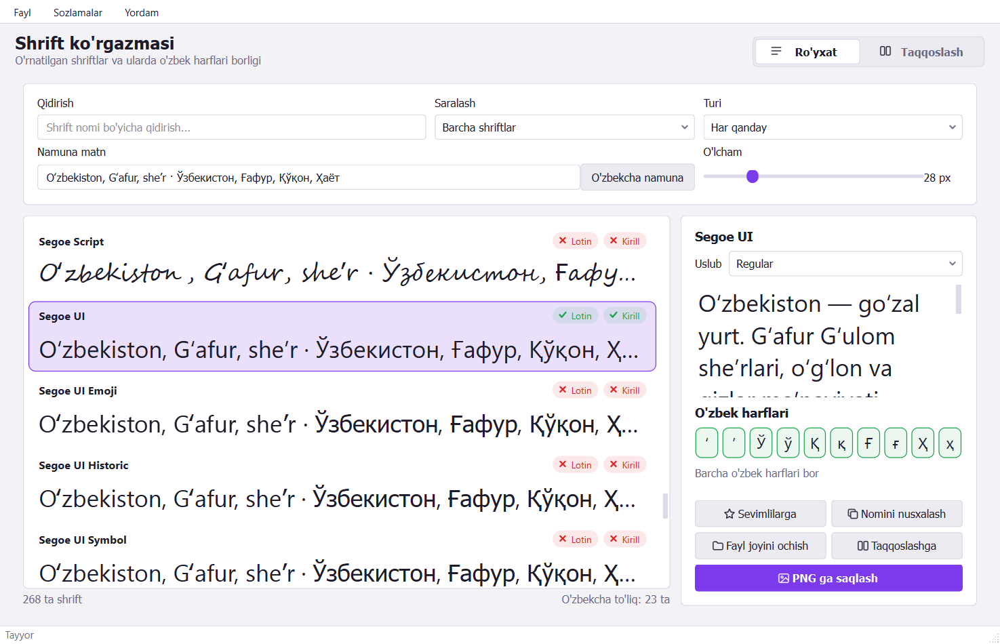
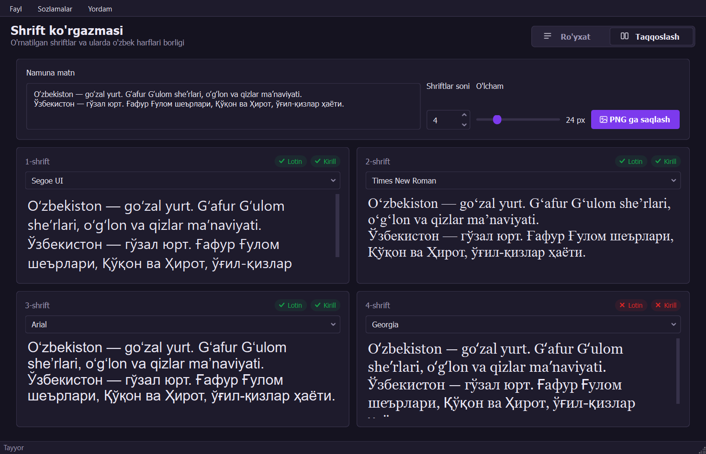

<h1 align="center">Shrift ko'rgazmasi</h1>

<b>Font Showcase</b> · Просмотр шрифтов

   
  
  
  
  

O'rnatilgan shriftlarni ko'rish va taqqoslash. Har bir shriftda o'zbek lotin (ʻ ʼ) va kirill (Ў Қ Ғ Ҳ) harflari bor-yo'qligi avtomatik tekshiriladi.

## Imkoniyatlar

- Barcha o'rnatilgan shriftlar bitta ro'yxatda, o'z matningiz va o'lcham bilan
- O'zbek lotin (U+02BB ʻ, U+02BC ʼ) va kirill (Ў ў Қ қ Ғ ғ Ҳ ҳ) belgilarini avtomatik tekshirish
- "Faqat o'zbekcha mos" saralash, qidiruv, monospace / proporsional filtr
- Sevimli shriftlar ro'yxati
- 2–4 shriftni yonma-yon taqqoslash
- Namunani PNG ga saqlash, nomini nusxalash, fayl joyini ochish
- 1000+ shriftda ham tez ishlaydi (faqat ko'ringan qatorlar chiziladi)
- O'zbek, rus, ingliz tillari; yorug' va qorong'i mavzu

## O'rnatish

1. [**ShriftKorgazmasi.exe**](https://github.com/eduhakimov/shrift-korgazmasi/releases/latest/download/ShriftKorgazmasi.exe) faylini yuklab oling.
2. Faylni ishga tushiring, o'rnatish shart emas.
3. Windows SmartScreen ogohlantirsa: **Batafsil → Baribir ishga tushirish**.

**Tizim talablari:** Windows 10 (1809+) / Windows 11, x64

---

## Русский

Просмотр и сравнение установленных шрифтов. Для каждого шрифта автоматически проверяется наличие узбекских латинских (ʻ ʼ) и кириллических (Ў Қ Ғ Ҳ) букв.

- Все установленные шрифты в одном списке с вашим текстом и размером
- Автопроверка узбекской латиницы (U+02BB ʻ, U+02BC ʼ) и кириллицы (Ў ў Қ қ Ғ ғ Ҳ ҳ)
- Фильтр «только узбекские», поиск, моно / пропорциональные
- Избранные шрифты
- Сравнение 2–4 шрифтов рядом
- Экспорт образца в PNG, копирование имени, открытие расположения файла
- Быстро даже при 1000+ шрифтов (рисуются только видимые строки)
- Узбекский, русский, английский; светлая и тёмная тема

## English

Browse and compare installed fonts. Each font is automatically checked for Uzbek Latin (ʻ ʼ) and Cyrillic (Ў Қ Ғ Ҳ) glyphs.

- All installed fonts in one list with your own text and size
- Automatic check of Uzbek Latin (U+02BB ʻ, U+02BC ʼ) and Cyrillic (Ў ў Қ қ Ғ ғ Ҳ ҳ) glyphs
- "Uzbek-compatible only" filter, search, monospace / proportional filter
- Favourite fonts
- Compare 2–4 fonts side by side
- Export preview as PNG, copy font name, open file location
- Fast with 1000+ fonts (only visible rows are drawn)
- Uzbek, Russian, English; light and dark themes

---

## Muallif / Author

**Bahtiyorjon Hakimov** (Hakimov Bahtiyorjon Muzaffar o'g'li), [github.com/eduhakimov](https://github.com/eduhakimov)

© 2026 Bahtiyorjon Hakimov. Barcha huquqlar himoyalangan. / Все права защищены. / All rights reserved.
Batafsil: [LICENSE](LICENSE) · Uchinchi tomon komponentlari: [THIRD_PARTY_NOTICES.md](THIRD_PARTY_NOTICES.md)
