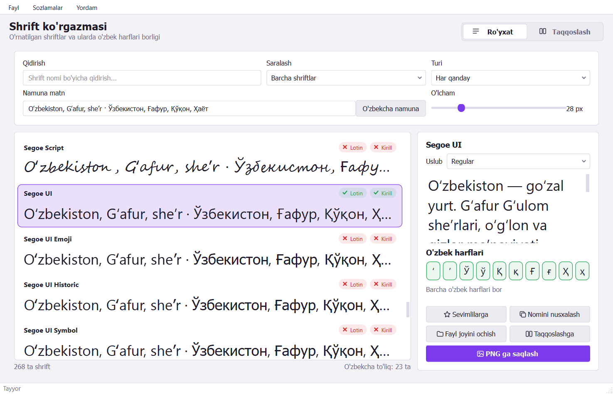
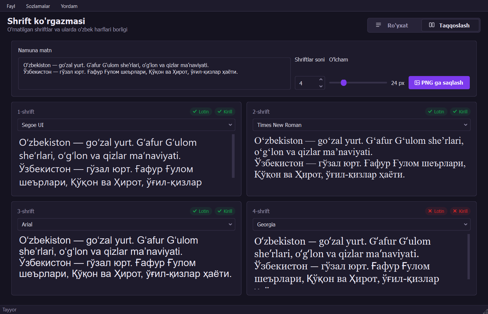

# Shrift ko‘rgazmasi: Foydalanish qo‘llanmasi

Muallif: Hakimov Bahtiyorjon. Versiya: 1.0.2.

## 1. Umumiy ma’lumot

“Shrift ko‘rgazmasi” – kompyuteringizda o‘rnatilgan shriftlarni ko‘rish va taqqoslash uchun dastur. U barcha shriftlarni siz yozgan matnda bitta ro‘yxatda ko‘rsatadi va har bir shriftda o‘zbek lotin (o‘, g‘ harflari va tutuq belgisi) hamda o‘zbek kirill (Ў, Қ, Ғ, Ҳ) harflari borligini avtomatik tekshiradi.

Dastur o‘zbek tilidagi hujjat, taqdimot, plakat yoki veb-sahifa uchun shrift tanlaydigan dizaynerlar, kotiblar, o‘qituvchilar, talabalar va nashriyot xodimlari uchun mo‘ljallangan. Dastur shriftlarni o‘rnatmaydi va o‘zgartirmaydi, faqat ko‘rsatadi. Internet kerak emas.

Qo‘llanmada tugma va bo‘lim nomlari dasturning o‘zbekcha interfeysidagi kabi keltirilgan.

Dastur quyidagi imkoniyatlarga ega:

- barcha o‘rnatilgan shriftlarni o‘z matningiz va o‘lchamingizda bitta ro‘yxatda ko‘rish;
- har bir shriftda o‘zbek lotin va kirill harflari borligini avtomatik tekshirish;
- shriftlarni o‘zbek harflari mavjudligi, turi va nomi bo‘yicha saralash;
- sevimli shriftlar ro‘yxatini yuritish;
- 2–4 shriftni bir xil matnda yonma-yon taqqoslash;
- namunani PNG rasmga saqlash, shrift nomini nusxalash va fayl joyini ochish.
Dastur ayniqsa o‘zbek tilida lotin va kirill yozuvlarida birga ishlaydigan foydalanuvchilar uchun foydali: bitta saralash orqali ikkala yozuvni ham to‘liq qo‘llab-quvvatlovchi shriftlarni topish mumkin.

## 2. Tizim talablari

- Operatsion tizim: Windows 10 (1809 va undan yuqori) yoki Windows 11, 64 bitli.
- Internet: talab qilinmaydi.
- O‘rnatish: talab qilinmaydi, dastur bitta .exe fayldan iborat.
- Dastur kompyuterda o‘rnatilgan shriftlar bilan ishlaydi; qancha ko‘p shrift o‘rnatilgan bo‘lsa, birinchi tekshiruv shuncha uzoq davom etadi, lekin u fonda bajariladi va natijalar eslab qolinadi.

## 3. O‘rnatish va ishga tushirish

1. Dasturning GitHub sahifasidagi (https://github.com/eduhakimov/shrift-korgazmasi) “Releases” bo‘limidan ShriftKorgazmasi.exe faylini yuklab oling.
2. Faylni qulay papkaga joylashtiring va ikki marta bosib ishga tushiring.
3. Windows SmartScreen ogohlantirish chiqarsa, “Batafsil” havolasini, so‘ng “Baribir ishga tushirish” tugmasini bosing.
4. Birinchi ishga tushirishda dastur barcha shriftlarni fonda tekshiradi: ro‘yxat ostida “Tekshirilmoqda: …” yozuvi ko‘rinadi. Bu vaqtda dasturdan foydalanishingiz mumkin. Keyingi safar faqat yangi o‘rnatilgan shriftlar tekshiriladi.
Dastur yopilganda oyna o‘lchami va joylashuvi eslab qolinadi. Dastur kompyuterda hech qanday o‘zgarish qilmaydi, shuning uchun uni o‘chirish uchun .exe faylni o‘chirish kifoya.

## 4. Dastur oynasi bilan tanishish

Oynaning yuqori qismida menyu satri (“Fayl”, “Sozlamalar”, “Yordam”), dastur nomi va o‘ng tomonda “Ro‘yxat” hamda “Taqqoslash” ko‘rinishlarini almashtiruvchi tugmalar joylashgan.

“Ro‘yxat” ko‘rinishida yuqorida boshqaruv kartochkasi bor: “Qidirish”, “Saralash”, “Turi”, “Namuna matn”, “O‘zbekcha namuna” tugmasi va “O‘lcham” slayderi. Uning ostida chapda shriftlar ro‘yxati, o‘ngda tanlangan shrift tafsilotlari joylashgan. Ro‘yxatdagi har bir shrift yonida “Lotin” va “Kirill” belgilari bor: yashil belgi – harflar bor, qizil belgi – yo‘q. Ro‘yxat ostida shriftlar soni (masalan, “268 ta shrift”) va o‘zbekcha to‘liq mos shriftlar soni ko‘rsatiladi.

Tafsilotlar panelida shrift nomi, “Uslub” ro‘yxati, katta namuna, “O‘zbek harflari” kataklari va amal tugmalari joylashgan.

“Taqqoslash” ko‘rinishida yuqorida “Namuna matn” maydoni, “Shriftlar soni”, “O‘lcham” va “PNG ga saqlash” tugmasi, ostida esa tanlangan sondagi shrift kataklari joylashgan. Har bir katakda tartib raqami (masalan, “1-shrift”), shriftni tanlash ro‘yxati, “Lotin” va “Kirill” belgilari hamda namuna matn ko‘rsatiladi.

Ro‘yxatda sevimli shriftlar nomi yonida yulduzcha belgisi bilan ko‘rsatiladi. Oynaning eng pastki satrida dastur holati va bajarilgan amallar haqida qisqa xabarlar chiqadi (masalan, “Saqlandi: …” yoki “Taqqoslashga qo‘shildi: …”).

Ro‘yxat va tafsilotlar paneli bir-biriga bog‘langan: ro‘yxatda tanlangan shrift darhol o‘ng panelda ko‘rsatiladi.

*1-rasm. “Ro‘yxat” ko‘rinishi: boshqaruv kartochkasi, shriftlar ro‘yxati va tafsilotlar paneli*

## 5. Asosiy amallar

Quyida dasturning asosiy amallari tavsiflangan. Odatiy ish tartibi: o‘zbekcha mos shriftlarni saralash – o‘z matningizda ko‘rish – yoqqanlarini sevimlilarga qo‘shish – taqqoslash – tanlangan shrift nomini nusxalab, hujjatda qo‘llash.

**O‘zbek tiliga mos shrift topish.**

1. “Saralash” ro‘yxatidan “O‘zbekcha to‘liq (lotin + kirill)” ni tanlang. Ro‘yxatda faqat har ikki yozuvdagi o‘zbek harflari bor shriftlar qoladi.
2. Faqat lotin yozuvidagi matn uchun “O‘zbek lotin”, faqat kirill yozuvi uchun “O‘zbek kirill” variantini tanlash mumkin.
3. Ro‘yxatdan shriftni tanlang va o‘ngdagi panelda uning namunasini va “O‘zbek harflari” kataklarini ko‘rib chiqing.
**O‘z matningizda ko‘rish.**

1. “Namuna matn” maydoniga o‘z matningizni yozing (masalan, hujjat sarlavhasi yoki tashkilot nomi). Barcha shriftlar shu matn bilan ko‘rsatiladi.
2. “O‘lcham” slayderi bilan namuna o‘lchamini o‘zgartiring.
3. Standart o‘zbekcha namunaga qaytish uchun “O‘zbekcha namuna” tugmasini bosing.
**Qidirish va saralash.** “Qidirish” maydoniga shrift nomining bir qismini yozing (masalan, “segoe”). “Turi” ro‘yxatida “Monospace (bir xil kenglik)” – dasturlash va jadvallar uchun, “Proporsional” – oddiy matn uchun, “Belgili (Symbol)” – belgi va piktogramma shriftlarini ko‘rish uchun.

**Shrift tafsilotlari.** Tanlangan shrift uchun “Uslub” ro‘yxatidan uslubni (masalan, Regular, Bold, Italic) tanlang. “O‘zbek harflari” bo‘limida har bir maxsus belgi alohida katakda ko‘rsatiladi. Yo‘q belgilar ajratib ko‘rsatiladi va ularning ro‘yxati beriladi; namuna matnida bunday harf boshqa shriftdan olinadi yoki bo‘sh kvadrat bo‘lib chiqadi.

**Sevimlilar.** Yoqqan shriftni tanlab, “Sevimlilarga” tugmasini bosing. Sevimlilar ro‘yxatini ko‘rish uchun “Saralash” da “Sevimlilar” ni tanlang. Shriftni ro‘yxatdan olib tashlash uchun “Sevimlilardan olish” tugmasini bosing.

**Shrift nomini nusxalash va faylini topish.** “Nomini nusxalash” tugmasi shrift nomini almashish buferiga ko‘chiradi; uni Word, PowerPoint yoki grafik muharrirga qo‘yish mumkin. “Fayl joyini ochish” tugmasi Windows Explorer’da shrift fayli joylashgan papkani ochadi. Fayl topilmasa, dastur bu tizim yoki ilova ichidagi shrift bo‘lishi mumkinligini xabar qiladi.

**Shriftlarni taqqoslash.**

1. Ro‘yxatda shriftni tanlab, “Taqqoslashga” tugmasini bosing. Buni bir nechta shrift uchun takrorlang.
2. Yuqoridagi “Taqqoslash” tugmasi bilan taqqoslash ko‘rinishiga o‘ting.
3. “Shriftlar soni” maydonida 2, 3 yoki 4 ni tanlang. Har bir katakdagi ro‘yxatdan shriftni o‘zgartirish mumkin.
4. “Namuna matn” maydonidagi matn va “O‘lcham” barcha kataklarga qo‘llanadi. Har bir katakda “Lotin” va “Kirill” belgilari ko‘rinadi.
**Namunani rasmga saqlash.** Tafsilotlar panelida yoki taqqoslash ko‘rinishida “PNG ga saqlash” tugmasini bosing, fayl nomi va joyini tanlang. Rasmda namuna va shrift nomi, uslubi hamda o‘lchami ko‘rsatiladi.

**Shrift tanlash bo‘yicha maslahatlar.**

- Rasmiy hujjatlar uchun “O‘zbekcha to‘liq (lotin + kirill)” belgilangan shriftlardan foydalaning: hujjat qaysi yozuvda yozilishidan qat’i nazar, harflar bir xil ko‘rinadi.
- Namunani hujjatdagi haqiqiy o‘lchamga yaqin o‘lchamda ko‘ring: kichik o‘lchamda yaxshi o‘qiladigan shrift sarlavhada boshqacha taassurot qoldirishi mumkin.
- Bezakli (masalan, qo‘lyozmaga o‘xshash) shriftlarni faqat sarlavha va qisqa matnlar uchun ishlating.
- Hujjatni boshqa kompyuterda ochish kerak bo‘lsa, u yerda ham shu shrift o‘rnatilganini tekshiring.
**Tanlangan shriftni hujjatda qo‘llash.** “Nomini nusxalash” tugmasi bilan shrift nomini nusxalang, so‘ng Word, PowerPoint yoki boshqa dasturdagi shrift maydoniga qo‘ying. Bu nomni qo‘lda yozishdagi xatolarning oldini oladi.

**Uslublarni ko‘rish.** Ko‘plab shriftlar bir nechta uslubga ega (oddiy, qalin, kursiv va boshqalar). Tafsilotlar panelidagi “Uslub” ro‘yxatidan uslubni tanlang – namuna shu uslubda ko‘rsatiladi. Uslub tanlangan holda “PNG ga saqlash” bosilsa, rasmda ham shu uslub ishlatiladi.

**Ro‘yxat bo‘ylab harakatlanish.** Ro‘yxatni sichqoncha g‘ildiragi bilan aylantiring, shriftni bosib tanlang. Klaviaturadagi yuqoriga va pastga strelkalari bilan ham qo‘shni shriftga o‘tish mumkin.

**Rasmga nima chiziladi?** Tafsilotlar panelidan saqlangan rasmda sizning namuna matningiz va undan keyin dasturning standart o‘zbekcha namunasi, tepada esa shrift nomi, uslubi va o‘lchami ko‘rsatiladi. Taqqoslash ko‘rinishidan saqlangan rasmda esa barcha kataklar ekrandagi ko‘rinishda tasvirlanadi.

*2-rasm. “Taqqoslash” ko‘rinishi (qorong‘i mavzu): to‘rtta shrift yonma-yon*

## 6. Sozlamalar

- **Til.** “Sozlamalar → Til” menyusida o‘zbek, rus yoki ingliz tilini tanlang; dastur qayta ishga tushadi.
- **Mavzu.** “Sozlamalar → Mavzu” menyusida “Tizim bo‘yicha”, “Yorug‘” yoki “Qorong‘i” ni tanlang.
- Namuna matn, o‘lcham, sevimli shriftlar hamda taqqoslash ko‘rinishidagi shriftlar soni va tanlangan shriftlar keyingi ishga tushirishda eslab qolinadi.
Sozlamalar avtomatik saqlanadi, alohida “Saqlash” tugmasi yo‘q. Interfeys tilini o‘zgartirganda dastur qayta ishga tushadi, sevimlilar va namuna matni saqlanib qoladi.

## 7. Ma’lumotlarni saqlash va xavfsizlik

- Dastur shriftlarni o‘rnatmaydi, o‘chirmaydi va o‘zgartirmaydi. Windows reestridagi shriftlar ro‘yxati faqat o‘qiladi.
- Sozlamalar, sevimli shriftlar va o‘zbek harflari tekshiruvi natijalari (JSON formatidagi kesh fayli) %APPDATA%\BahtiyorSoft\shrift-korgazmasi papkasida saqlanadi. Xatolar jurnali (log.txt) ham shu papkada.
- PNG rasmlar faqat siz tanlagan joyga saqlanadi.
- Dastur internetga ulanmaydi.
- Kesh fayli o‘chirilsa, dastur keyingi ishga tushirishda barcha shriftlarni qayta tekshiradi; bu ma’lumot yo‘qolishiga olib kelmaydi.
- Sozlamalar fayli shikastlangan bo‘lsa, dastur standart qiymatlar bilan ishga tushadi.
- Dastur Windows reestriga va shriftlar papkasiga hech narsa yozmaydi.

## 8. Ko‘p uchraydigan savollar va muammolar

**Ro‘yxatda “Hech narsa topilmadi” yozuvi chiqdi.** Qidiruv yoki saralash shartlariga mos shrift yo‘q. Qidiruv maydonini tozalang yoki “Saralash” da “Barcha shriftlar” ni tanlang.

**Yangi o‘rnatgan shriftim ko‘rinmayapti.** Shriftni o‘rnatgandan keyin dasturni qayta ishga tushiring.

**Shrift yonida belgilar o‘rnida “tekshirilmoqda…” yozuvi bor.** Dastur shriftlarni fonda tekshirmoqda; bir oz kuting.

**“Shrift fayli topilmadi” xabari.** Ba’zi shriftlar tizim ichida yoki ilovalar bilan birga keladi va alohida fayl sifatida ro‘yxatdan o‘tmagan bo‘ladi.

**Shrift “Lotin” bo‘yicha qizil belgilangan, lekin men unda o‘zbekcha yozaman.** Dastur o‘, g‘ harflari va tutuq belgisi uchun U+02BB va U+02BC belgilarini tekshiradi. Matningizda oddiy apostrof yoki boshqa belgi ishlatilgan bo‘lishi mumkin.

**Qo‘llanmani qayerdan ochaman?** “Yordam → Qo‘llanma” menyusi yoki F1 tugmasi orqali.

**Dastur shrift o‘rnata oladimi?** Yo‘q. Dastur faqat o‘rnatilgan shriftlarni ko‘rsatadi va taqqoslaydi. Shriftni o‘rnatish uchun Windows’ning standart usulidan foydalaning, so‘ng dasturni qayta ishga tushiring.

**Nima uchun ba’zi eski shriftlar ro‘yxatda yo‘q?** Masshtablanmaydigan eski rastr shriftlar va tizimning ichki shriftlari ro‘yxatga kiritilmaydi.

**Taqqoslash rasmi qayerga saqlanadi?** “PNG ga saqlash” bosilganda saqlash oynasi ochiladi va sukut bo‘yicha “Hujjatlar” papkasi taklif etiladi; boshqa joyni ham tanlash mumkin.

**Namuna matnda ba’zi harflar boshqacha ko‘rinyapti.** Tanlangan shriftda shu harf yo‘q: u boshqa shriftdan olinmoqda yoki bo‘sh kvadrat bo‘lib chiqmoqda. Tafsilotlar panelidagi “O‘zbek harflari” bo‘limida qaysi belgi yetishmasligini tekshiring va to‘liq mos shriftni tanlang.

**O‘lchamni qanday katta qilaman?** “O‘lcham” slayderini o‘ngga suring; ro‘yxat ko‘rinishida eng katta qiymat 96 piksel.

**Monospace shriftlar qayerda kerak?** Dastur kodi, jadval va ustunlarda tekislangan matnlar uchun: ularda har bir belgi bir xil kenglikka ega. “Turi” ro‘yxatida “Monospace (bir xil kenglik)” ni tanlang.

**Taqqoslashga nechta shrift qo‘shish mumkin?** 2 dan 4 tagacha. Ko‘proq shriftni solishtirish uchun ro‘yxat ko‘rinishidan foydalaning: u yerda barcha shriftlar bir xil matnda ko‘rinadi.

