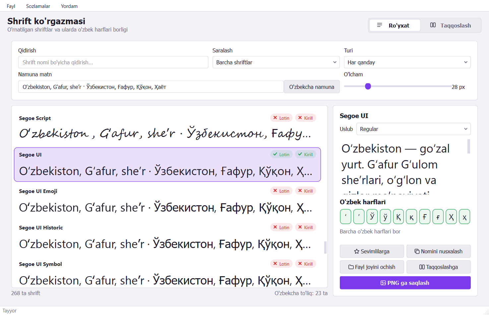
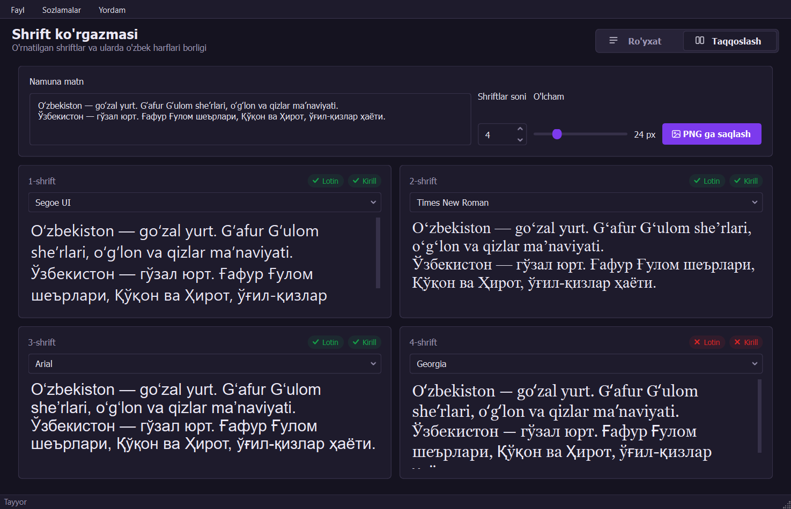

UDK: 004.42:003.2

# O‘rnatilgan shriftlarni ko‘rish, taqqoslash va ularda o‘zbek lotin hamda kirill harflari mavjudligini avtomatik tekshirish uchun dasturiy vosita

**Hakimov Bahtiyorjon**  
*[ish joyi, lavozimi, elektron pochta]*

**Annotatsiya.** Maqolada Windows kompyuterida o‘rnatilgan shriftlarni ko‘rish va taqqoslash uchun ishlab chiqilgan “Shrift ko‘rgazmasi” dasturi tavsiflanadi. Dasturning asosiy xususiyati – har bir shriftda o‘zbek lotin alifbosidagi o‘, g‘ harflari va tutuq belgisi uchun ishlatiladigan U+02BB va U+02BC kodli belgilar hamda o‘zbek kirill alifbosining Ў, Қ, Ғ, Ҳ harflari mavjudligini avtomatik tekshirish. Dastur barcha shriftlarni foydalanuvchi matni va o‘lchami bilan bitta ro‘yxatda ko‘rsatadi, ularni o‘zbek harflari mavjudligi, turi va nomi bo‘yicha saralaydi, sevimlilar ro‘yxatini yuritadi, ikki-to‘rt shriftni yonma-yon taqqoslaydi va namunani PNG rasmga saqlaydi. Tekshiruv natijalari diskda keshlanadi. Qt shrift tizimiga asoslangan arxitektura va testlar yoritiladi.

*Kalit so‘zlar:* shrift, tipografiya, o‘zbek alifbosi, Unicode, glif, PySide6, shriftlarni taqqoslash.

**Программное средство для просмотра и сравнения установленных шрифтов и автоматической проверки наличия в них узбекских латинских и кириллических букв**

**Аннотация.** В статье описывается программа «Shrift ko‘rgazmasi» («Выставка шрифтов») для просмотра и сравнения шрифтов, установленных на компьютере с Windows. Главная особенность программы – автоматическая проверка наличия в каждом шрифте символов U+02BB и U+02BC, используемых в узбекской латинице для букв o‘, g‘ и апострофа, а также букв Ў, Қ, Ғ, Ҳ узбекской кириллицы. Программа показывает все шрифты в одном списке с текстом и размером пользователя, фильтрует их по наличию узбекских букв, типу и названию, ведёт список избранного, сравнивает от двух до четырёх шрифтов рядом и сохраняет образец в PNG. Результаты проверки кэшируются на диске. Рассматриваются архитектура на основе шрифтовой системы Qt и тесты.

*Ключевые слова:* шрифт, типографика, узбекский алфавит, Unicode, глиф, PySide6, сравнение шрифтов.

**A software tool for browsing and comparing installed fonts and automatically checking them for Uzbek Latin and Cyrillic letters**

**Abstract.** The paper describes “Shrift ko‘rgazmasi” (Font Showcase), an application for browsing and comparing fonts installed on a Windows computer. Its main feature is an automatic check of every font for the characters U+02BB and U+02BC, used in the Uzbek Latin alphabet for the letters o‘ and g‘ and for the apostrophe, and for the letters Ў, Қ, Ғ, Ҳ of the Uzbek Cyrillic alphabet. The program shows all fonts in one list with the user’s text and size, filters them by Uzbek letter support, type and name, keeps a list of favourites, compares two to four fonts side by side and saves a sample as a PNG image. Check results are cached on disk. The architecture based on the Qt font system and the tests are discussed.

*Keywords:* font, typography, Uzbek alphabet, Unicode, glyph, PySide6, font comparison.

## Kirish

Matnli hujjatlar, taqdimotlar, plakatlar, veb-sahifalar va bosma mahsulotlar tayyorlashda shrift tanlash muhim bosqich hisoblanadi. O‘zbek tilidagi materiallar uchun bu vazifa qo‘shimcha murakkablikka ega: o‘zbek lotin alifbosida o‘ va g‘ harflari hamda tutuq belgisi, o‘zbek kirill alifbosida esa Ў, Қ, Ғ, Ҳ kabi maxsus harflar mavjud. Ko‘plab shriftlarda bu belgilar uchun glif (harfning grafik shakli) bo‘lmaydi.

Agar tanlangan shriftda kerakli glif bo‘lmasa, operatsion tizim yoki dastur uni boshqa shriftdan oladi yoki uning o‘rniga bo‘sh kvadrat chiqaradi. Natijada so‘z ichida bir harf boshqacha ko‘rinishda chiqadi, matnning bir xilligi buziladi, bosma mahsulotda esa xato faqat chop etilgandan keyin aniqlanishi mumkin. Dizayner, kotib yoki o‘qituvchi shriftlarni birma-bir sinab ko‘rishga majbur bo‘ladi, kompyuterda yuzlab shrift o‘rnatilgan bo‘lsa, bu ko‘p vaqt oladi.

Operatsion tizimning standart shriftlar ko‘ruvchisi shriftni bittadan ochib ko‘rsatadi va unda o‘zbek harflari borligini maxsus tekshirmaydi. Grafik muharrirlardagi shrift ro‘yxatlari ham odatda faqat shrift nomi yoki qisqa namunani ko‘rsatadi. Shu sababli o‘zbek tilidagi matn uchun mos shriftlarni tez topish imkonini beruvchi ixtisoslashgan vosita amaliy ahamiyatga ega.

“Raqamli O‘zbekiston – 2030” strategiyasida raqamli kontent va mahalliy dasturiy mahsulotlarni rivojlantirish vazifalari belgilangan. O‘zbek tilidagi raqamli matnlarning to‘g‘ri ko‘rinishini ta’minlash bu vazifalarning muhim tarkibiy qismidir.

Tadqiqotning maqsadi – kompyuterda o‘rnatilgan barcha shriftlarni o‘zbek tilidagi namunada ko‘rsatuvchi, ularda o‘zbek lotin va kirill harflari mavjudligini avtomatik tekshiruvchi va shriftlarni taqqoslash imkonini beruvchi dasturiy vositani ishlab chiqish. Maqolada shu maqsadda yaratilgan “Shrift ko‘rgazmasi” dasturi taqdim etiladi.

Maqolaning amaliy yangiligi shundaki, unda shriftlarni ko‘rish vositasi o‘zbek alifbosining raqamli muhitdagi xususiyatlariga yo‘naltirilgan: kompyuterdagi barcha shriftlar o‘zbek lotin va kirill yozuvlaridagi maxsus belgilar mavjudligi bo‘yicha avtomatik tekshiriladi, natija esa ro‘yxatda ko‘rgazmali belgilar orqali ko‘rsatiladi va saralash mezoni sifatida ishlatiladi.

Maqola quyidagi tuzilishga ega: avval mavjud yechimlar tahlil qilinib, vositaga qo‘yiladigan talablar shakllantiriladi; so‘ngra dastur arxitekturasi va algoritmlari, asosiy funksiyalar, sinov natijalari, afzallik va cheklovlar bayon etiladi.

Ishning o‘quv-uslubiy jihati ham e’tiborga loyiq: dastur belgilar kodlash va shriftlar tuzilishiga oid nazariy tushunchalarni o‘zbek alifbosi misolida ko‘rgazmali namoyish qilish vositasi bo‘lishi mumkin.

## Muammoning qo‘yilishi va mavjud yechimlar tahlili

Shriftlarni ko‘rish vositalarini uch guruhga ajratish mumkin. Birinchi guruh – operatsion tizimga o‘rnatilgan shriftlar ko‘ruvchisi va shriftlar sozlamalari sahifasi: ular har bir shriftni alohida ochadi va o‘zbek harflarini tekshirish funksiyasiga ega emas. Ikkinchi guruh – grafik va matn muharrirlaridagi shrift ro‘yxatlari: ular shriftni amalda qo‘llash imkonini beradi, lekin ko‘plab shriftlarni bir vaqtda bir xil matnda ko‘rish va saralash imkoniyati cheklangan. Uchinchi guruh – professional shrift boshqaruvchilari va onlayn shrift kataloglari: ularning bir qismi shrift belgilari jadvalini ko‘rsatadi, lekin o‘zbek alifbosiga xos tekshiruvni bevosita taklif etmaydi yoki internet orqali ishlaydi.

O‘zbek tilining ikki yozuvda qo‘llanishi va lotin yozuvida apostrofsimon belgilarning bir nechta Unicode varianti mavjudligi masalani yanada murakkablashtiradi. Dastur kodida o‘zbek lotin alifbosi uchun o‘ va g‘ harflaridagi belgi sifatida U+02BB kodli belgi, tutuq belgisi sifatida U+02BC kodli belgi qabul qilingan. Ko‘plab shriftlarda oddiy apostrof va tirnoq belgilari bor, ammo bu ikki belgi bo‘lmasligi mumkin.

Shu tahlil asosida ishlab chiqiladigan vositaga quyidagi talablar qo‘yildi:

- kompyuterdagi barcha o‘rnatilgan shriftlarni bitta ro‘yxatda, foydalanuvchi tanlagan matn va o‘lchamda ko‘rsatish;
- har bir shriftda o‘zbek lotin va kirill harflari mavjudligini avtomatik tekshirish va natijani ko‘rgazmali belgilash;
- shriftlarni o‘zbek harflari mavjudligi, turi (monospace, proporsional, belgili) va nomi bo‘yicha saralash;
- sevimli shriftlar ro‘yxatini yuritish;
- bir nechta shriftni bir xil matnda yonma-yon taqqoslash;
- namunani rasm sifatida saqlash, shrift nomini nusxalash va shrift fayli joyini ochish;
- yuzlab va minglab shriftlar bilan tez ishlash;
- tizim shriftlarini o‘zgartirmaslik va internetsiz ishlash.
Masala yana shu bilan murakkablashadiki, glif yo‘qligi ko‘pincha darhol sezilmaydi. Zamonaviy matn chizish tizimlari yetishmayotgan belgini avtomatik ravishda boshqa shriftdan olishi mumkin: natijada so‘z ekranda o‘qiladi, lekin bitta harf boshqa shriftda, boshqa qalinlik va o‘lchamda chiqadi. Bunday nuqson bosma mahsulotda yoki boshqa kompyuterda ochilgan hujjatda yaqqol ko‘rinadi. Shu sababli tekshiruv ko‘z bilan baholashga emas, balki shrift ichidagi glif jadvalini to‘g‘ridan-to‘g‘ri so‘rashga asoslanishi kerak.

Qo‘yilgan talablarning barchasi dasturda amalga oshirildi; ularning bajarilishi keyingi bo‘limlarda va avtomatik testlarda ko‘rsatiladi.

## Tadqiqot metodologiyasi va dasturiy arxitektura

Dastur Python 3.12 tilida yozilgan, grafik interfeysi PySide6 (Qt 6) asosida qurilgan. Shriftlar bilan ishlash to‘liq Qt shrift tizimiga – QFontDatabase va QRawFont sinflariga tayanadi. Shrift fayllarini nomi bo‘yicha topishda zaxira usul sifatida Pillow kutubxonasi ishlatiladi. Dastur PyInstaller yordamida bitta bajariladigan fayl ko‘rinishida yig‘iladi.

Dastur paketi quyidagi modullardan iborat:

- **fonts** – shrift oilalari ro‘yxati, uslublar, turini aniqlash, o‘zbek harflarini tekshirish, saralash, tekshiruv natijalari keshi va shrift fayllarini topish;
- **render** – shrift namunasini rasmga chizish;
- **icons** – interfeys belgilari;
- **window** – asosiy oyna, ro‘yxat va taqqoslash ko‘rinishlari;
- **strings** – uch tildagi interfeys matnlari.
Fonts moduli grafik interfeysdan alohida yozilgan va testlar uni bevosita tekshiradi.

**Shriftlar ro‘yxati.** Dastur Qt shrift bazasidan barcha oilalarni oladi va ulardan yashirin (ichki) oilalarni, vertikal yozuv uchun mo‘ljallangan “@” bilan boshlanuvchi oilalarni hamda masshtablanmaydigan eski rastr shriftlarni chiqarib tashlaydi. Qolgan oilalar alifbo tartibida, katta-kichik harflarni farqlamasdan saralanadi.

**O‘zbek harflarini tekshirish algoritmi.** Har bir shrift oilasi uchun QRawFont obyekti yaratiladi va uning yordamida har bir tekshiriladigan belgi uchun shriftda glif mavjudligi so‘raladi. Lotin yozuvi uchun U+02BB va U+02BC belgilari hamda O, G, Sh, Ch harflari tekshiriladi; kirill yozuvi uchun Ў, ў, Қ, қ, Ғ, ғ, Ҳ, ҳ maxsus harflari hamda bir qator asosiy kirill harflari tekshiriladi. Barcha belgilar mavjud bo‘lsa, shrift tegishli yozuvni qo‘llab-quvvatlaydi deb hisoblanadi. Belgili (Symbol) shriftlar har ikki yozuv uchun mos emas deb belgilanadi. Shriftni o‘qib bo‘lmasa, natija “noma’lum” deb qoldiriladi.

**Fon tekshiruvi va kesh.** Yuzlab shriftni bir vaqtda tekshirish interfeysni to‘xtatib qo‘ymasligi uchun tekshiruv taymer orqali kichik guruhlarda (har safar o‘n ikkitadan) bajariladi; har bir guruhdan keyin ro‘yxat yangilanadi va holat qatorida jarayon (“Tekshirilmoqda: i / n”) ko‘rsatiladi. Tekshiruv natijalari foydalanuvchining %APPDATA% papkasidagi kesh fayliga yoziladi, shuning uchun keyingi ishga tushirishlarda faqat yangi shriftlar tekshiriladi. Kesh fayli versiya raqamiga ega: format o‘zgarganda eski kesh e’tiborsiz qoldiriladi; fayl shikastlangan bo‘lsa, kesh bo‘sh holatdan boshlanadi.

**Tez chizish.** Shriftlar ro‘yxati Qt’ning model-ko‘rinish arxitekturasi asosida qurilgan: ma’lumotlar modeli va har bir qatorni chizuvchi delegat alohida. Ko‘rinish faqat ekranda ko‘ringan qatorlarni chizadi, shu sababli dastur hujjatlarida qayd etilganidek, minglab shriftlar o‘rnatilgan kompyuterda ham ro‘yxat tez ishlaydi.

**Shrift faylini topish.** Shrift fayli joyini ochish uchun dastur Windows reestridagi o‘rnatilgan shriftlar ro‘yxatini faqat o‘qish rejimida ko‘rib chiqadi va oila nomini yozuv nomlari bilan normallashtirilgan holda (qavs ichidagi “TrueType”, “OpenType” kabi qo‘shimchalarsiz) solishtiradi; avval aniq, keyin boshlanishi bo‘yicha mos yozuvlar olinadi. Fayl yo‘li nisbiy bo‘lsa, tizim va foydalanuvchi shriftlari papkalarida qidiriladi. Reestrda topilmasa, zaxira usul sifatida shrift fayllari ichidagi nom bo‘yicha qidiruv bajariladi.

**Xavfsizlik.** Dastur shriftlarni o‘rnatmaydi, o‘chirmaydi va o‘zgartirmaydi; reestrga yozmaydi, faqat o‘qiydi. Foydalanuvchi ma’lumotlari – sozlamalar, sevimlilar va tekshiruv keshi – faqat dasturning o‘z papkasida saqlanadi. Dastur tarmoqqa murojaat qilmaydi.

**Shrift turini aniqlash.** Monospace (bir xil kenglikdagi) shriftlar Qt shrift bazasidagi belgilangan kenglik xususiyati bo‘yicha, belgili shriftlar esa yozuv tizimlari ro‘yxati bo‘yicha aniqlanadi: yozuv tizimlari orasida belgilar (Symbol) bo‘lib, lotin yozuvi bo‘lmagan shrift belgili deb hisoblanadi. Proporsional shriftlar – monospace bo‘lmagan barcha shriftlar.

**Saralash.** Saralash funksiyasi uch mezonni ketma-ket qo‘llaydi: qidiruv so‘rovi (so‘rovdagi har bir so‘z shrift nomida bo‘lishi kerak, katta-kichik harflar farqlanmaydi), saralash rejimi (barcha, sevimlilar, o‘zbek lotin, o‘zbek kirill yoki ikkalasi) va shrift turi. Tekshiruvi hali tugamagan shriftlar o‘zbek harflari bo‘yicha saralashda ko‘rsatilmaydi; tekshiruv tugagach, ro‘yxat avtomatik yangilanadi.

**Ro‘yxat qatorini chizish.** Delegat har bir qator uchun shrift nomini, sevimli shrift belgisini, “Lotin” va “Kirill” holat belgilarini hamda foydalanuvchi matnini shu shriftning o‘zida chizadi. Tanlangan qator ajratib ko‘rsatiladi. Namuna o‘lchami yoki matni o‘zgarganda delegatning ichki keshi tozalanadi va ko‘ringan qatorlar qayta chiziladi.

**Namuna rasmini yaratish.** Render moduli namunani belgilangan kenglikdagi oq fonli rasmga chizadi: avval matn egallaydigan balandlik o‘lchanadi, so‘ng shu balandlikka mos rasm yaratiladi, yuqorida kulrang rangda shrift nomi, uslubi va o‘lchami, ostida esa namuna matni so‘zlar bo‘yicha qatorlarga bo‘lingan holda chiziladi. Taqqoslash ko‘rinishida esa kataklar to‘ri ekrandagi ko‘rinishida rasmga olinadi.

**Sozlamalarni saqlash.** Namuna matni, o‘lcham, sevimli shriftlar ro‘yxati, taqqoslash ko‘rinishidagi shriftlar soni va tanlangan shriftlar foydalanuvchining sozlamalar faylida saqlanadi. Sozlamalar faylidagi qiymatlar o‘qilganda tekshiriladi: masalan, o‘lcham ruxsat etilgan oraliqdan (10–96 piksel) tashqarida bo‘lsa yoki sevimlilar ro‘yxati noto‘g‘ri turda bo‘lsa, standart qiymat qo‘llanadi. Bu shikastlangan sozlamalar bilan ham dasturning barqaror ishga tushishini ta’minlaydi va alohida test bilan tekshiriladi.

## Amalga oshirish va asosiy funksiyalar

Dastur oynasi ikki ko‘rinishga ega: “Ro‘yxat” va “Taqqoslash”; ular oynaning yuqori o‘ng burchagidagi almashtirgich orqali tanlanadi.

**Ro‘yxat ko‘rinishi.** Yuqoridagi kartochkada “Qidirish” maydoni, “Saralash” va “Turi” ro‘yxatlari, “Namuna matn” maydoni, “O‘zbekcha namuna” tugmasi va “O‘lcham” slayderi (10 dan 96 pikselgacha) joylashgan. “Saralash” ro‘yxatida beshta variant bor: “Barcha shriftlar”, “Sevimlilar”, “O‘zbekcha to‘liq (lotin + kirill)”, “O‘zbek lotin” va “O‘zbek kirill”. “Turi” ro‘yxatida “Har qanday”, “Monospace (bir xil kenglik)”, “Proporsional” va “Belgili (Symbol)” variantlari mavjud. Qidiruv shrift nomi bo‘yicha, bo‘shliq bilan ajratilgan bir nechta so‘z bo‘yicha bajariladi.

Chap tomondagi ro‘yxatda har bir shrift nomi, uning namunasi va ikkita belgi – “Lotin” va “Kirill” – ko‘rsatiladi: yashil belgi yozuv qo‘llab-quvvatlanishini, qizil belgi esa yo‘qligini bildiradi. Ro‘yxat ostida shriftlar soni va o‘zbek tilini to‘liq qo‘llab-quvvatlovchi shriftlar soni chiqadi.

O‘ng tomondagi tafsilotlar panelida tanlangan shriftning nomi, “Uslub” ro‘yxati (masalan, Regular, Bold, Italic), kengaytirilgan namuna matni va “O‘zbek harflari” bo‘limi joylashgan. Bu bo‘limda har bir maxsus belgi alohida katakda ko‘rsatiladi; yo‘q belgilar ajratib ko‘rsatiladi va ularning ro‘yxati beriladi, barchasi mavjud bo‘lsa, “Barcha o‘zbek harflari bor” yozuvi chiqadi. Panel ostida “Sevimlilarga”, “Nomini nusxalash”, “Fayl joyini ochish”, “Taqqoslashga” va “PNG ga saqlash” tugmalari bor.

**Taqqoslash ko‘rinishi.** Bu ko‘rinishda “Namuna matn” maydoni, “Shriftlar soni” (2 dan 4 gacha), “O‘lcham” slayderi va “PNG ga saqlash” tugmasi joylashgan. Har bir katakda shriftni tanlash ro‘yxati, “Lotin” va “Kirill” belgilari hamda bir xil matnning tanlangan shriftdagi ko‘rinishi beriladi. Ro‘yxat ko‘rinishidagi “Taqqoslashga” tugmasi tanlangan shriftni taqqoslash kataklaridan biriga qo‘shadi.

**Namunani saqlash.** “PNG ga saqlash” funksiyasi namunani oq fonda, shrift nomi, uslubi va o‘lchami ko‘rsatilgan sarlavha bilan rasmga chizadi; rasm balandligi matn hajmiga qarab avtomatik tanlanadi. Bunday rasm hamkasblarga shrift variantlarini yuborish yoki hisobotga qo‘shish uchun qulay.

**O‘zbekcha namuna.** Dasturda standart namuna matni sifatida o‘zbek lotin va kirill yozuvidagi qisqa jumlalar ishlatiladi; ular tekshiriladigan barcha maxsus belgilarni o‘z ichiga oladi. Foydalanuvchi o‘z matnini kiritgandan keyin “O‘zbekcha namuna” tugmasi bilan standart matnga qaytishi mumkin. Tafsilotlar panelida esa uzunroq, ikki yozuvdagi to‘liq namuna ko‘rsatiladi.

**Ko‘rgazmali ma’lumotlar.** Rasmlarda tasvirlangan holatda ro‘yxatda Segoe Script, Segoe UI Emoji, Segoe UI Historic va Segoe UI Symbol shriftlari uchun “Lotin” va “Kirill” belgilari qizil, Segoe UI uchun esa yashil rangda ko‘rsatilgan; taqqoslash ko‘rinishida Segoe UI, Times New Roman va Arial shriftlari ikkala yozuv uchun mos, Georgia esa mos emas deb belgilangan. Bu natijalar rasmlar olingan kompyuterdagi shrift versiyalariga tegishli.

**Tafsilotlar panelining yangilanishi.** Ro‘yxatda boshqa shrift tanlanganda yoki fon tekshiruvi tugaganda tafsilotlar paneli avtomatik yangilanadi: uslublar ro‘yxati, namuna, harflar kataklari va fayl yo‘li yangi shriftga moslanadi. Tanlangan shrift uchun PNG fayl nomi shrift nomidan avtomatik taklif qilinadi.

Tafsilotlar panelidan saqlanadigan rasmga foydalanuvchi matni va undan keyin standart o‘zbekcha namuna birga chiziladi, o‘lcham esa kamida 24 piksel qilib olinadi; shu tufayli rasmda shriftning o‘zbek harflari bilan ko‘rinishi har doim aks etadi.

*1-rasm. “Ro‘yxat” ko‘rinishi: shriftlar namunasi, “Lotin” va “Kirill” belgilari, o‘ngda Segoe UI shriftining tafsilotlari va o‘zbek harflari kataklari*

*2-rasm. Qorong‘i mavzudagi “Taqqoslash” ko‘rinishi: to‘rtta shrift bir xil o‘zbekcha matnda*

## Sinov va natijalar

Dastur pytest freymvorkida yozilgan avtomatik testlar bilan tekshiriladi. Tests papkasidagi to‘rtta test faylida jami 17 ta test funksiyasi mavjud.

- Shriftlar moduli testlari (9 ta funksiya): namunaviy matnda o‘zbek harflarining mavjudligi, shriftlar ro‘yxatining bo‘sh emasligi, Arial shriftining o‘zbek harflarini qo‘llab-quvvatlashi, belgili shriftning o‘zbekcha mos emas deb belgilanishi, saralash funksiyasi, reestr yozuvlarini oila nomi bilan solishtirish, shrift faylini topish, kesh faylini yozib qayta o‘qish, namunani PNG rasmga chizish.
- Chuqur ssenariy testlari (4 ta funksiya): kompyuterda o‘rnatilgan har bir shrift oilasi uchun namuna xatosiz chizilishi, Unicode belgilari bor yo‘lga PNG saqlash, taqqoslashda noma’lum va bo‘sh shrift nomi bilan ishlash, shikastlangan sozlamalar va kesh fayllari bilan ishga tushish.
- Oyna ssenariylari (2 ta funksiya): tafsilotlar paneli va fayl yo‘llarini yangilash, sevimlilarga qo‘shish va taqqoslashga yuborish.
- Tutun testlari (2 ta funksiya): asosiy oynaning yaratilishi va tarjimalarning uch tilda to‘liqligi.
Dastur interfeysi o‘zbek, rus va ingliz tillarida ishlaydi va Windows 10 (1809+) hamda Windows 11 uchun mo‘ljallangan. Rasmda ko‘rsatilgan holatda dastur kompyuterdagi 268 ta shriftni ro‘yxatga olgan va ulardan 23 tasini o‘zbek tilini to‘liq qo‘llab-quvvatlovchi deb belgilagan; bu son har bir kompyuterda o‘rnatilgan shriftlar to‘plamiga bog‘liq va umumlashtiruvchi ko‘rsatkich emas.

Chuqur ssenariy testlaridan birida kompyuterda o‘rnatilgan barcha shrift oilalari ketma-ket ko‘rib chiqiladi: har biri uchun o‘zbek harflari tekshiruvi xatosiz yakunlanishi, tafsilotlar paneli shu shriftga o‘tishi va o‘zbek harflari bor qisqa namuna rasmga chizilishi tekshiriladi. Bu test dasturning real tizimdagi turli shriftlar bilan barqaror ishlashini tasdiqlashga qaratilgan. Arial shrifti bo‘yicha test esa tekshiruv algoritmining ma’lum natija bilan mosligini tekshiradi.

Mazkur ishda ro‘yxatni chizish tezligi va tekshiruv davomiyligi miqdoriy o‘lchanmagan.

Shunday qilib, testlar dasturning uchta asosiy jihatini qamrab oladi: o‘zbek harflarini tekshirish mantig‘ining to‘g‘riligi, real tizimdagi barcha shriftlar bilan barqarorlik va foydalanuvchi ma’lumotlari (sozlamalar, kesh, PNG fayllar) bilan ishonchli ishlash.

## Muhokama

Dasturning asosiy afzalligi – o‘zbek tiliga xos muammoga yo‘naltirilganlik. Foydalanuvchi “O‘zbekcha to‘liq” saralashini tanlab, kompyuterdagi yuzlab shriftlar orasidan o‘zbek lotin va kirill matnlari uchun yaroqli shriftlarni bir zumda ajratib oladi. Tafsilotlar panelidagi harflar kataklari aynan qaysi belgi yetishmasligini ko‘rsatadi, bu esa qisman mos shriftlardan ongli ravishda foydalanish imkonini beradi.

Ikkinchi afzallik – samaradorlik. Faqat ko‘ringan qatorlarni chizish, tekshiruvni kichik guruhlarda fonda bajarish va natijalarni keshlash dasturni ko‘p shrift o‘rnatilgan kompyuterlarda ham qulay qiladi.

Uchinchi afzallik – xavfsizlik va shaffoflik: dastur tizim shriftlarini o‘zgartirmaydi, reestrni faqat o‘qiydi va internetga ulanmaydi.

Arxitektura nuqtai nazaridan shrift tekshiruvini operatsion tizimning matn chizish natijasiga emas, balki shrift glif jadvaliga tayantirish muhim yechim hisoblanadi: shu tufayli boshqa shriftdan avtomatik almashtirish holatlari tekshiruv natijasiga ta’sir qilmaydi. Tekshiruv mantig‘ining grafik interfeysdan ajratilganligi esa uni testlarda bevosita sinash va kelajakda boshqa alifbolar uchun ham qo‘llash imkonini beradi: buning uchun tekshiriladigan belgilar to‘plamini kengaytirish kifoya.

Cheklovlar: tekshiruv glif mavjudligini aniqlaydi, lekin uning sifatini (masalan, belgining boshqa harflar bilan uyg‘unligi yoki uslubiy mosligi) baholamaydi; tekshiruv shrift oilasining asosiy uslubi bo‘yicha bajariladi, ayrim uslublarda belgilar to‘plami farq qilishi mumkin; lotin yozuvi uchun faqat U+02BB va U+02BC belgilari tekshiriladi, amaliyotda ishlatiladigan boshqa apostrofsimon belgilar (masalan, U+2018 va U+2019) alohida tekshirilmaydi; dastur shrift o‘rnatish yoki o‘chirish funksiyalarini taqdim etmaydi; faqat kompyuterda o‘rnatilgan shriftlar ko‘rib chiqiladi.

Rivojlantirish istiqbollari: o‘rnatilmagan shrift fayllarini ko‘rish, boshqa apostrofsimon belgilarni ham tekshirish, har bir uslub bo‘yicha alohida tekshiruv va tanlangan shriftlar ro‘yxatini eksport qilish.

Umuman olganda, dastur tor ixtisoslashgan, ammo amaliy ahamiyatga ega vazifani hal qiladi va o‘zbek tilining raqamli muhitdagi ko‘rinishi sifatini oshirishga xizmat qiluvchi vositalar qatorini to‘ldiradi.

## Xulosa

Maqolada o‘rnatilgan shriftlarni ko‘rish, taqqoslash va ularda o‘zbek lotin hamda kirill harflari mavjudligini avtomatik tekshirish uchun “Shrift ko‘rgazmasi” dasturi taqdim etildi. Dastur Qt shrift tizimi asosida har bir shriftda kerakli glif mavjudligini aniqlaydi, natijalarni keshlaydi, shriftlarni o‘zbek harflari, turi va nomi bo‘yicha saralaydi, sevimlilar ro‘yxatini yuritadi, 2–4 shriftni yonma-yon taqqoslaydi va namunani PNG rasmga saqlaydi. Dasturning ishlashi 17 ta avtomatik test funksiyasi bilan tekshiriladi.

Ishning amaliy ahamiyati shundaki, o‘zbek tilidagi matnlar uchun shrift tanlashda uchraydigan keng tarqalgan nuqsonning – kerakli harf yo‘qligining – oldini olish vositasi yaratildi; ilmiy-uslubiy ahamiyati esa belgilar kodlash va shrift tuzilishi tushunchalarini o‘zbek alifbosi misolida ko‘rgazmali o‘rgatish imkoniyatida ko‘rinadi.

Dastur dizaynerlar, nashriyot va matbaa xodimlari, kotiblar, o‘qituvchilar va talabalar uchun o‘zbek tilidagi materiallarga mos shrift tanlash vositasi sifatida, shuningdek kompyuter grafikasi, tipografiya va axborot texnologiyalari fanlarida belgilar kodlash va shriftlar tuzilishini o‘rgatish uchun qo‘llanishi mumkin.

Keyingi tadqiqotlarda tekshiruvni har bir shrift uslubi bo‘yicha alohida bajarish va boshqa apostrofsimon belgilarni ham qamrab olish maqsadga muvofiq.

## Foydalanilgan adabiyotlar

1. O‘zbekiston Respublikasi Prezidentining 2020-yil 5-oktabrdagi PF-6079-son “Raqamli O‘zbekiston – 2030” strategiyasini tasdiqlash va uni samarali amalga oshirish chora-tadbirlari to‘g‘risida”gi Farmoni.
2. The Unicode Consortium. The Unicode Standard [Elektron resurs]. – URL: https://www.unicode.org/standard/standard.html (murojaat sanasi: 27.11.2026).
3. Microsoft. OpenType Specification [Elektron resurs]. – URL: https://learn.microsoft.com/en-us/typography/opentype/spec/ (murojaat sanasi: 27.11.2026).
4. The Qt Company. QFontDatabase Class. Qt 6 Documentation [Elektron resurs]. – URL: https://doc.qt.io/qt-6/qfontdatabase.html (murojaat sanasi: 27.11.2026).
5. The Qt Company. QRawFont Class. Qt 6 Documentation [Elektron resurs]. – URL: https://doc.qt.io/qt-6/qrawfont.html (murojaat sanasi: 27.11.2026).
6. Python Software Foundation. Python 3.12 Documentation [Elektron resurs]. – URL: https://docs.python.org/3.12/ (murojaat sanasi: 27.11.2026).
7. The Qt Company. Qt for Python (PySide6) Documentation [Elektron resurs]. – URL: https://doc.qt.io/qtforpython-6/ (murojaat sanasi: 27.11.2026).
8. Pillow (PIL Fork) Documentation [Elektron resurs]. – URL: https://pillow.readthedocs.io/ (murojaat sanasi: 27.11.2026).
9. PyInstaller Development Team. PyInstaller Manual [Elektron resurs]. – URL: https://pyinstaller.org/en/stable/ (murojaat sanasi: 27.11.2026).
10. Hakimov B. Shrift ko‘rgazmasi: dastur manba kodi va tavsifi [Elektron resurs]. – URL: https://github.com/eduhakimov/shrift-korgazmasi (murojaat sanasi: 27.11.2026).
