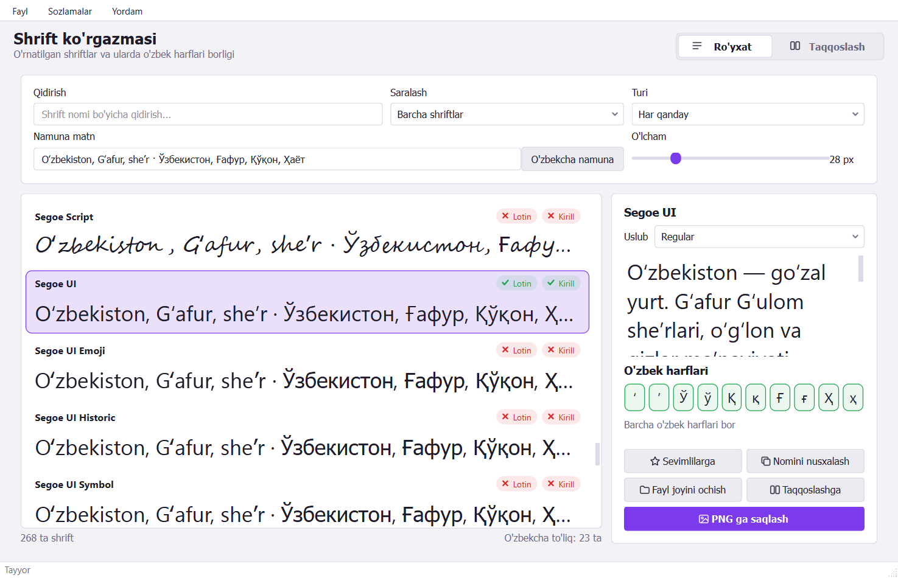

# Shrift ko‘rgazmasi: Uslubiy ko‘rsatma

Muallif: Hakimov Bahtiyorjon. Versiya: 1.0.2.

## 1. Uslubiy ko‘rsatmaning maqsadi va vazifalari

Mazkur uslubiy ko‘rsatma “Shrift ko‘rgazmasi” dasturidan oliy ta’lim muassasalari, kollej va texnikumlarda o‘quv mashg‘ulotlari o‘tkazishda hamda tashkilotlarda hujjat va bosma mahsulotlar tayyorlashda foydalanish tartibini belgilaydi.

Maqsad – tinglovchilarda shrift, glif va belgilar kodlash (Unicode) tushunchalari, o‘zbek alifbosining raqamli muhitdagi xususiyatlari va o‘zbek tilidagi matnlar uchun mos shrift tanlash ko‘nikmalarini shakllantirish.

Vazifalar:

- shrift, shrift oilasi, uslub va glif tushunchalarini tushuntirish;
- Unicode tizimi va o‘zbek lotin hamda kirill alifbolaridagi maxsus belgilarning kodlari bilan tanishtirish;
- shriftda glif yo‘qligi oqibatlarini (boshqa shriftdan almashtirish, bo‘sh kvadrat) ko‘rsatish;
- shrift turlarini (serifli, serifsiz, monospace, belgili) farqlashga o‘rgatish;
- hujjat yoki dizayn uchun shrift tanlashni asoslashga o‘rgatish;
- shriftlarning litsenziyaviy cheklovlariga hurmat madaniyatini shakllantirish.
Mashg‘ulot yakunida tinglovchi bilishi kerak: shrift, glif, shrift oilasi va uslub tushunchalari, Unicode tizimining vazifasi, o‘zbek lotin va kirill alifbolaridagi maxsus belgilar, shrift turlari. Tinglovchi bajara olishi kerak: o‘zbek tiliga mos shriftlarni topish, yetishmayotgan belgilarni aniqlash, shriftlarni taqqoslash va tanlovni asoslash, namunani rasm ko‘rinishida tayyorlash.

Mashg‘ulot uchun Windows 10 yoki 11 o‘rnatilgan kompyuterlar va dastur yetarli; internet va qo‘shimcha jihozlar talab qilinmaydi.

## 2. Qo‘llash sohasi va maqsadli auditoriya

Dasturdan quyidagi fanlar va kurslarda foydalanish tavsiya etiladi: “Kompyuter grafikasi”, “Tipografiya va shrift dizayni”, “Grafik dizayn”, “Nashriyot ishi va kompyuter verstkasi”, “Informatika va axborot texnologiyalari” (belgilar kodlash mavzusi), “Ish yuritish va kotiblik ishi”, “Veb-dizayn”.

Maqsadli auditoriya:

- dizayn, kompyuter grafikasi va nashriyot ishi yo‘nalishlari talabalari;
- informatika yo‘nalishi talabalari (Unicode va belgilar kodlash mavzusi uchun);
- kollej va texnikum o‘quvchilari;
- tashkilotlarning devonxona, matbuot xizmati va dizayn bo‘limlari xodimlari.
Kasbiy vazifalardan misollar: tashkilot blanki yoki taqdimot shabloni uchun o‘zbek lotin va kirill yozuvlarini to‘liq qo‘llab-quvvatlovchi shrift tanlash, plakat sarlavhasi uchun bir nechta shriftni taqqoslash va natijani rahbariyatga rasm ko‘rinishida yuborish, kirill yozuvidagi eski hujjatni qayta terish uchun mos shrift topish.

Dastur ikki darajada qo‘llanishi mumkin. Amaliy darajada u dizayn va ish yuritish bo‘yicha aniq vazifani – mos shrift tanlashni – hal qilish vositasi bo‘ladi. Nazariy darajada esa informatika fanlarida belgilar kodlash mavzusini ko‘rgazmali tushuntirish uchun xizmat qiladi: tinglovchi bir xil ko‘rinadigan, lekin turli kodga ega belgilar (masalan, turli apostrofsimon belgilar) mavjudligini va bu matnni qayta ishlashga qanday ta’sir qilishini amalda ko‘radi.

Tashkilotlarda dastur blank, xat, e’lon va taqdimot shablonlari uchun yagona shrift tanlashda qo‘l keladi: mas’ul xodim o‘zbekcha to‘liq mos shriftlarni taqqoslash rasmi bilan rahbariyatga taqdim etib, tanlovni asoslashi mumkin.

Kollej va texnikumlarda dastur “Ish yuritish” va “Kompyuter savodxonligi” fanlarida hujjat rasmiylashtirish madaniyatini shakllantirish uchun qo‘llanishi mumkin: o‘quvchilar o‘zbek harflarining to‘g‘ri ko‘rinishiga e’tibor berishni o‘rganadi.

## 3. O‘quv mashg‘ulotida foydalanish tartibi

80 daqiqalik amaliy mashg‘ulot rejasi:

1. **Tashkiliy qism (5 daqiqa).** Davomat, mavzu va maqsadni e’lon qilish, kompyuterlarda dastur ishga tushganini tekshirish.
2. **Nazariy qism (20 daqiqa).** Shrift va glif tushunchalari. Shrift oilasi va uslublar. Serifli, serifsiz, monospace va belgili shriftlar. Unicode tizimi: har bir belgining yagona kodi. O‘zbek lotin alifbosida o‘, g‘ va tutuq belgisi uchun ishlatiladigan belgilar, o‘zbek kirill alifbosining maxsus harflari. Glif yo‘q bo‘lganda nima bo‘ladi. Dastur oynasi bilan tanishtirish.
3. **Amaliy qism (45 daqiqa).** Tinglovchilar “Amaliy topshiriqlar” bo‘limidagi 1–6-topshiriqlarni bajaradi: o‘zbekcha mos shriftlarni topadi, harflar kataklarini tahlil qiladi, shriftlarni taqqoslaydi va natijani PNG rasmga saqlaydi.
4. **Yakuniy qism (10 daqiqa).** Natijalarni muhokama qilish: kompyuterdagi shriftlarning qancha qismi o‘zbek tilini to‘liq qo‘llab-quvvatlashi, qaysi belgilar eng ko‘p yetishmasligi. Nazorat savollari, baholash, mustaqil ish topshirig‘i.
Mashg‘ulotdan oldin dasturni kamida bir marta ishga tushirib qo‘yish tavsiya etiladi: birinchi ishga tushirishda barcha shriftlar fonda tekshiriladi va natijalar keshlanadi.

Nazariy qismda o‘qituvchi proyektor orqali bitta o‘zbekcha matnni avval to‘liq mos shriftda, so‘ng qizil belgilangan shriftda ko‘rsatib, glif almashtirilishi yoki bo‘sh kvadrat chiqishini namoyish qilishi tavsiya etiladi. So‘ngra “O‘zbek harflari” kataklari orqali aynan qaysi belgi yetishmasligi ko‘rsatiladi.

Amaliy qismni juftlikda tashkil etish mumkin: tinglovchilar turli vazifalar (rasmiy hujjat, plakat, taqdimot, jadval) uchun shrift tanlaydi va bir-birining tanlovini asoslash bo‘yicha savollar beradi.

Mashg‘ulot natijasi sifatida har bir tinglovchi taqqoslash rasmi (PNG), yetishmayotgan belgilar jadvali va tanlangan shriftlar ro‘yxatini topshiradi.

Agar mashg‘ulot ikki akademik soatdan iborat bo‘lsa, ikkinchi soatda tinglovchilar tanlagan shriftlaridan foydalanib, blank yoki e’lon maketini matn muharririda tayyorlaydi va natijani guruhda muhokama qiladi.

*1-rasm. Mashg‘ulotda tahlil qilinadigan “O‘zbek harflari” kataklari va shriftlar ro‘yxati*

## 4. Amaliy topshiriqlar

Topshiriqlar murakkablik darajasi ortib borish tartibida joylashtirilgan. Har bir topshiriq uchun kutilgan natija ko‘rsatilgan; o‘qituvchi uni tinglovchining jadvali, saqlangan rasm va dastur oynasidagi holat orqali tekshiradi. Kompyuterlardagi shriftlar to‘plami farq qilishi mumkinligi sababli sonli natijalar tinglovchilar orasida farqlanishi tabiiy.

1. **Mos shriftlarni topish.** “Saralash” da “O‘zbekcha to‘liq (lotin + kirill)” ni tanlang va kompyuterdagi shriftlarning necha foizi o‘zbek tilini to‘liq qo‘llab-quvvatlashini hisoblang. Kutilgan natija: ro‘yxat ostidagi sonlar asosida hisoblangan foiz.
2. **Yetishmayotgan belgilar.** Qizil belgilangan uchta shriftni tanlab, “O‘zbek harflari” kataklari bo‘yicha qaysi belgilar yetishmasligini yozing. Kutilgan natija: shriftlar va yetishmayotgan belgilar jadvali.
3. **O‘z matni.** “O‘zbekcha namuna” tugmasini bosing (namuna lotin va kirill yozuvidagi maxsus belgilarni o‘z ichiga oladi), so‘ng yetishmayotgan belgili shriftni tanlab, namuna matn qanday ko‘rinishini kuzating. Kutilgan natija: tinglovchi glif almashtirilishi yoki bo‘sh kvadrat chiqishini izohlaydi.
4. **Turlar bo‘yicha saralash.** “Turi” ro‘yxati yordamida monospace shriftlar ichidan o‘zbekcha to‘liq moslarini toping. Kutilgan natija: dasturlash yoki jadvallar uchun mos shriftlar ro‘yxati.
5. **Taqqoslash.** Rasmiy hujjat uchun to‘rtta o‘zbekcha mos shriftni “Taqqoslash” ko‘rinishida solishtiring va eng mosini asoslab tanlang. Kutilgan natija: tanlov va uning qisqa asoslanishi.
6. **PNG namuna.** Tanlangan shriftlar taqqoslashini PNG rasmga saqlang. Kutilgan natija: shrift nomlari ko‘rsatilgan rasm fayli.
7. **Sevimlilar to‘plami.** Plakat, rasmiy hujjat va taqdimot uchun mos shriftlardan iborat sevimlilar ro‘yxatini tuzing. Kutilgan natija: “Sevimlilar” saralashida ko‘rinadigan 5–8 shrift.
8. **Shrift fayli.** Tanlangan shriftning fayl joyini “Fayl joyini ochish” orqali toping va fayl kengaytmasi (TTF, OTF, TTC) haqida ma’lumot yozing. Kutilgan natija: shrift fayli nomi va formati.
Vaqt yetmagan holda 7–8-topshiriqlar mustaqil ish sifatida uyga beriladi va keyingi mashg‘ulotda tekshiriladi.

Barcha topshiriqlar natijalari tinglovchining jadvaliga yoziladi: shrift nomi, turi, “Lotin” va “Kirill” holati, yetishmayotgan belgilar va xulosa.

## 5. Baholash mezonlari

Baholash amaliy topshiriqlar natijalari, ularning tahlili va nazorat savollariga javoblar asosida amalga oshiriladi.

Amaliy ish 100 ballik tizimda baholanadi:

- o‘zbekcha mos shriftlarni to‘g‘ri saralash va hisob-kitob – 15 ball;
- yetishmayotgan belgilarni aniqlash va izohlash – 20 ball;
- shriftlarni taqqoslash va tanlovni asoslash – 20 ball;
- PNG namuna va sevimlilar ro‘yxati – 15 ball;
- Unicode va glif tushunchalarini to‘g‘ri qo‘llash – 15 ball;
- nazorat savollariga javoblar – 15 ball.
Baho: 86–100 ball – “a’lo”, 71–85 – “yaxshi”, 55–70 – “qoniqarli”, 55 dan kam – “qoniqarsiz”.

Baholashda tinglovchining tanlovni asoslay olishi (nima uchun aynan shu shrift tanlangani, uning o‘zbek harflarini qo‘llab-quvvatlashi va vazifaga mosligi) muhim mezon hisoblanadi. Ballar jurnalda qayd etiladi.

Mustaqil ish natijalari ham shu mezonlar asosida baholanadi va joriy nazorat balliga qo‘shiladi.

## 6. Nazorat savollari

Savollar og‘zaki so‘rov yoki qisqa yozma nazorat uchun mo‘ljallangan. Har bir to‘liq va asoslangan javob uchun 1,5 ball beriladi.

1. Shrift va glif tushunchalarining farqi nimada?
2. Shrift oilasi va uslub nima?
3. Unicode tizimining vazifasi nimadan iborat?
4. O‘zbek lotin alifbosidagi o‘, g‘ va tutuq belgisi uchun dasturda qaysi Unicode belgilari tekshiriladi?
5. O‘zbek kirill alifbosining qaysi harflari rus alifbosida yo‘q?
6. Shriftda kerakli glif bo‘lmasa, matnda nima sodir bo‘ladi?
7. Monospace va proporsional shriftlarning farqi nimada va ular qayerda qo‘llanadi?
8. Nima uchun rasmiy hujjat uchun o‘zbek tilini to‘liq qo‘llab-quvvatlovchi shrift tanlash muhim?
9. Dastur tekshiruv natijalarini nima uchun keshlaydi?
10. Shriftlardan foydalanishda qanday litsenziyaviy cheklovlar bo‘lishi mumkin?
Javob berishda tinglovchi dasturdagi tegishli funksiyani, masalan, “O‘zbek harflari” kataklarini ko‘rsatib berishi tavsiya etiladi.

Yozma nazoratda tinglovchiga 10 daqiqa vaqt beriladi.

## 7. Mustaqil ish uchun tavsiyalar

- O‘z kompyuteringizdagi shriftlarni tahlil qilib, o‘zbek tilini to‘liq qo‘llab-quvvatlovchi shriftlar ro‘yxatini tuzing va ularni turlari bo‘yicha guruhlang.
- Unicode jadvallaridan o‘zbek lotin va kirill alifbolarining maxsus belgilari kodlarini topib, qisqa ma’lumotnoma tayyorlang.
- Tashkilotingiz yoki o‘quv muassasangiz uchun blank va taqdimot shabloniga mos shrift juftligini (sarlavha va matn uchun) tanlang va taqqoslash rasmini ilova qilib asoslang.
- Bitta o‘zbekcha matnni turli shriftlarda chop etib, ekrandagi va qog‘ozdagi ko‘rinishni solishtiring.
- Mustaqil ish natijalarini keyingi mashg‘ulotda qisqa chiqish shaklida taqdim eting.
- Turli apostrofsimon belgilar (U+0027, U+2018, U+2019, U+02BB, U+02BC) ro‘yxatini tuzib, ularning nomi va qo‘llanish sohasini Unicode manbalari asosida tavsiflang.
- Bitta o‘zbekcha jumlani turli apostrofsimon belgilar bilan yozib, ularni matn muharririda qidirish va almashtirish natijalarini solishtiring; bir xil ko‘rinadigan belgilar nima uchun turlicha qidirilishini tushuntiring.
- Tanlagan shriftingiz bilan o‘zbek lotin va kirill yozuvidagi bir sahifalik matnni terib, harflarning bir xil ko‘rinishini tekshiring va natijani PDF yoki rasm ko‘rinishida taqdim eting.

## 8. Xavfsizlik va axborot madaniyati qoidalari

- Shriftlar ham intellektual mulk hisoblanadi: tijorat maqsadlarida foydalanishdan oldin shrift litsenziyasini tekshiring.
- Noma’lum saytlardan shrift fayllarini yuklab olmang va o‘rnatmang: ular zararli dastur bo‘lishi mumkin.
- O‘quv kompyuterlarida shriftlarni faqat administrator ruxsati bilan o‘rnating yoki o‘chiring; dasturning o‘zi shriftlarni o‘zgartirmaydi.
- Rasmiy hujjatlarda o‘zbek harflarini to‘g‘ri belgilar bilan yozing va ularni to‘liq qo‘llab-quvvatlovchi shriftdan foydalaning.
- Kompyuter sinfida ishlash va texnika xavfsizligi qoidalariga rioya qiling.
- Dasturni faqat rasmiy GitHub sahifasidan yuklab oling.
- Mashg‘ulot yakunida o‘quv kompyuterida saqlangan PNG fayllaringizni o‘z saqlash vositangizga ko‘chirib, kompyuterdan o‘chiring.
- Taqqoslash rasmlarini tarqatishda shrift nomlari to‘g‘ri ko‘rsatilganini tekshiring, shunda qabul qiluvchi aynan shu shriftni topa oladi.
- Shriftlarni boshqa kompyuterga ko‘chirishda yoki hamkasblarga yuborishda ularning litsenziyasi bunga ruxsat berishini tekshiring.
- Ekrandan uzoq vaqt ishlaganda ko‘z charchamasligi uchun muntazam tanaffus qiling va mos o‘lcham hamda mavzuni (yorug‘ yoki qorong‘i) tanlang.
